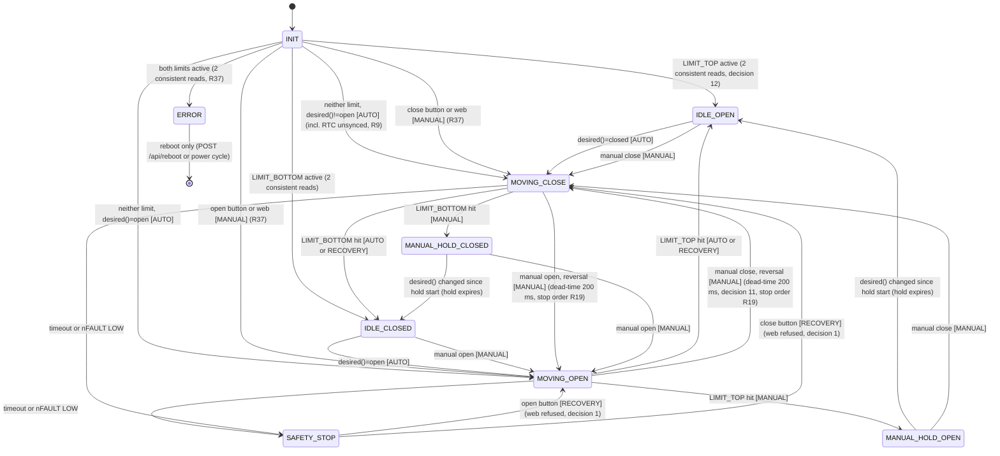

# State Machine & Control Logic — Smart Coop V2

Source of truth for implemented code: `src/state.py` (phases 1-3), `src/config.py`, `src/astro.py`.
Planned changes (phase 4 and later) are marked **PLANNED** and cite owner decision numbers from docs/decisions.md or resolutions R1-R23 ("Cross-doc resolutions") and R24-R40 ("Review round 3").
Light sensor removed; no light-based logic anywhere.

---

## 1. State Diagram

---

## 2. States

| State | Meaning | Motor | Green | Red | Yellow overlay |
|-------|---------|-------|-------|-----|----------------|
| `INIT` | Startup, reading limits (2 consistent reads, R37). Manual move allowed (MANUAL) | off | off | off | off (R23) |
| `IDLE_OPEN` | Door at top limit, auto logic active | off | solid | off | per RTC |
| `IDLE_CLOSED` | Door at bottom limit, auto logic active | off | off | solid | per RTC |
| `MOVING_OPEN` | Travelling up | forward | 1 Hz | off | per RTC |
| `MOVING_CLOSE` | Travelling down | backward | 1 Hz | off | per RTC |
| `MANUAL_HOLD_OPEN` | Opened by hand; auto blocked until `desired()` changes | off | solid | off | per RTC |
| `MANUAL_HOLD_CLOSED` | Closed by hand; auto blocked until `desired()` changes | off | off | solid | per RTC |
| `SAFETY_STOP` | Stopped by timeout or nFAULT; only physical button clears (decision 1, R23: AP does not clear) | off | off | 1 Hz | per RTC |
| `ERROR` | I2C dead / both limits / motor driver unreachable / DS3231 missing at boot (R18); reboot only | off | off | 4 Hz | per RTC |

Notes:
- Section 9 LED table is authoritative if the two tables disagree.
- `ERROR` is distinguishable from `SAFETY_STOP` by blink rate only (4 Hz vs 1 Hz).
- `LED_RED` is GPIO6 direct; works when I2C/PCF8574 is dead. Green and yellow are on PCF8574.

---

## 3. Movement Ownership (single owner)

- Only `_start_move(direction, trigger)` changes the state to `MOVING_*`. It bumps `_move_gen` and spawns exactly one `_run_move(direction, gen)` task.
- `_run_move` exits silently when `gen != _move_gen`. Older tasks can never overwrite the state.
- `control_loop` **never** spawns move tasks (phase 4).
- `_halt(state)`: bumps `_move_gen` (kills running `_run_move`), sets state, drives nSLEEP LOW first (GPIO kill switch, works with dead I2C), then `motor.stop()` best-effort (OSError swallowed).
- Stop order is the same everywhere (R19): halt, limit stop, timeout, nFAULT, reversal. nSLEEP LOW first, then IN1=IN2=LOW via PCF8574 (best effort). PCF8574 OSError on reversal → ERROR (R36).
- Reversal (manual opposite direction while moving): **PLANNED (phase 4)** — `_start_move` marks reversal; `_run_move` runs the stop order (R19), waits 200 ms, then drives opposite (nSLEEP HIGH ≥ 1 ms before drive). Current code calls `motor.stop()` in `manual_move` before `_start_move` and has no dead-time (state.py lines 102-103).

---

## 4. Movement Trigger

| Trigger | Set by | On limit reached |
|---------|--------|------------------|
| `AUTO` | `tick()` decision (`desired()`), INIT homing | `IDLE_OPEN` / `IDLE_CLOSED` |
| `MANUAL` | `manual_move(action, source)` from state INIT (R37), IDLE_* / MANUAL_HOLD_* / MOVING_* (reversal) | `MANUAL_HOLD_OPEN` / `MANUAL_HOLD_CLOSED` |
| `RECOVERY` | `manual_move` from `SAFETY_STOP` (physical button only, decision 1) | `IDLE_OPEN` / `IDLE_CLOSED` |

`_on_limit_reached()`: `MANUAL` → hold state; any other trigger → idle state. Calls `on_event` (R5).

---

## 5. Transition Table

| From | Condition | To | Trigger | Code |
|------|-----------|----|---------|------|
| `INIT` | LIMIT_TOP active only (2 consistent reads, R37) | `IDLE_OPEN` | — | `tick` |
| `INIT` | LIMIT_BOTTOM active only (2 consistent reads, R37) | `IDLE_CLOSED` | — | `tick` |
| `INIT` | both limits active (2 consistent reads, R37) | `ERROR` | — | `tick` → `_halt` |
| `INIT` | neither limit, `desired()=="open"` (2 consistent reads, R37) | `MOVING_OPEN` | AUTO | `tick` → `_start_move` |
| `INIT` | neither limit, otherwise (incl. RTC unsynced; 2 consistent reads, R37) | `MOVING_CLOSE` | AUTO | `tick` → `_start_move` (homing close, R9) |
| `INIT` | manual open / close (button or web) | `MOVING_OPEN` / `MOVING_CLOSE` | MANUAL | `manual_move` (R37) |
| `IDLE_CLOSED` | `desired()=="open"` | `MOVING_OPEN` | AUTO | `tick` |
| `IDLE_OPEN` | `desired()=="closed"` | `MOVING_CLOSE` | AUTO | `tick` |
| `IDLE_CLOSED` | manual open | `MOVING_OPEN` | MANUAL | `manual_move` |
| `IDLE_OPEN` | manual close | `MOVING_CLOSE` | MANUAL | `manual_move` |
| `MOVING_OPEN` | LIMIT_TOP hit, trigger AUTO/RECOVERY | `IDLE_OPEN` | — | `_on_limit_reached` |
| `MOVING_OPEN` | LIMIT_TOP hit, trigger MANUAL | `MANUAL_HOLD_OPEN` | — | `_on_limit_reached` |
| `MOVING_OPEN` | timeout (`safety.move_timeout_s`) | `SAFETY_STOP` | — | `tick` or `_run_move` → `_halt` |
| `MOVING_OPEN` | nFAULT LOW | `SAFETY_STOP` | — | `_run_move` → `_halt` |
| `MOVING_OPEN` | manual close (reversal) | `MOVING_CLOSE` | MANUAL | `manual_move` (dead-time 200 ms, R19 stop order, phase 4) |
| `MOVING_CLOSE` | LIMIT_BOTTOM hit, AUTO/RECOVERY | `IDLE_CLOSED` | — | `_on_limit_reached` |
| `MOVING_CLOSE` | LIMIT_BOTTOM hit, MANUAL | `MANUAL_HOLD_CLOSED` | — | `_on_limit_reached` |
| `MOVING_CLOSE` | timeout / nFAULT LOW | `SAFETY_STOP` | — | as above |
| `MOVING_CLOSE` | manual open (reversal) | `MOVING_OPEN` | MANUAL | `manual_move` (dead-time 200 ms, R19 stop order, phase 4) |
| `MOVING_*` | same-direction manual | no-op (returns False; web 200) | — | `manual_move` |
| `MANUAL_HOLD_OPEN` | `desired()` != `_hold_desired` | `IDLE_OPEN`, then `MOVING_CLOSE` in same tick if `desired()=="closed"` | AUTO | `tick` |
| `MANUAL_HOLD_CLOSED` | `desired()` != `_hold_desired` | `IDLE_CLOSED`, then `MOVING_OPEN` if `desired()=="open"` | AUTO | `tick` |
| `MANUAL_HOLD_OPEN` | manual close | `MOVING_CLOSE` | MANUAL | `manual_move` |
| `MANUAL_HOLD_CLOSED` | manual open | `MOVING_OPEN` | MANUAL | `manual_move` |
| `MANUAL_HOLD_*` | same-direction manual | no-op (returns False; web 200) | — | `manual_move` |
| `SAFETY_STOP` | open button (source=button) | `MOVING_OPEN` | RECOVERY | `manual_move` |
| `SAFETY_STOP` | close button (source=button) | `MOVING_CLOSE` | RECOVERY | `manual_move` |
| `SAFETY_STOP` | any manual with source=web | refused (returns False; web route → HTTP 409, R1) | — | `manual_move` (decision 1) |
| `SAFETY_STOP` | `tick()` | no move; `_read_clock` only (day change, `rtc_synced`, `_last_local`, R30) | — | `tick` |
| `SAFETY_STOP` | AP session start (both buttons 3 s) | AP runs, state unchanged (R23) | — | `ap_session` |
| `ERROR` | any manual, any tick | no move (reboot only); tick still runs `_read_clock` (R30) | — | `manual_move`, `tick` |
| any | 3 consecutive I2C `OSError` | `ERROR` | — | `_i2c_call` → `_halt` |
| any | DS3231 missing at boot (`boot_ok` False) | `ERROR` | — | `main` → `enter_error()` (R12, R18) |
| `MOVING_*` | `OSError` on PCF8574 motor write at start or reversal (`stop` / drive, R36) | `ERROR` | — | `_run_move` → `_halt` |

---

## 6. Decision Logic

`tick()` runs every 2 s from `control_loop`. Synchronous, no asyncio, no I/O beyond RTC/limit reads.

Order inside `tick()`:
1. `MOVING_*` → only timeout backstop check; return.
2. `SAFETY_STOP` / `ERROR` → `_read_clock()` only (day-change hook, `rtc_synced`, `_last_local`; R30), then return. Never moves.
3. `INIT` → limit read, 2 consistent reads for all four outcomes (decision 12, R37); both limits → `ERROR`; one limit → idle state; neither → homing (step 6).
4. `_read_clock()` → `(synced, now)` or None on I2C failure (return).
5. `want = desired(now) if synced else None`.
6. `INIT` still → homing `_start_move("open" if want=="open" else "close", AUTO)`; return (R9: close homing also when unsynced).
7. Hold expiry: `MANUAL_HOLD_*` and `want is not None` and `want != _hold_desired` → idle state.
8. `IDLE_CLOSED` and `want=="open"` → `MOVING_OPEN` AUTO. `IDLE_OPEN` and `want=="closed"` → `MOVING_CLOSE` AUTO.

### Schedule

- `today_schedule = (open_min, close_min)` local minutes, refreshed in `_read_clock` when local date changes.
- Open = sunrise(−0.833°) + `schedule.open_after_sunrise_min`. Close = civil dusk(−6°) + `schedule.close_after_dusk_min`. NOAA formula, ±2 min (`src/astro.py`).
- `desired(now)`: None if `today_schedule` None (unsynced) or `open >= close`; else `"open"` if `open <= now < close`, else `"closed"`.
- `config_warning = "open >= close: no auto moves today"` when `open >= close`.

### Hold ("manual hold until next scheduled change")

- `manual_move` stores `_hold_desired = desired(now)`.
- Hold ends when `desired(now)` differs from `_hold_desired` (schedule boundary crossed).
- While RTC unsynced or on a no-auto day, `want` is None → hold does not expire.
- First valid `want` that differs from `_hold_desired` expires the hold, including when `_hold_desired` is None (hold set while unsynced). Intended (R38, supersedes R9 wording).

### Time

- DS3231 stores CET (UTC+1), never adjusted for DST. DST offset applied in logic layer only (`local_minutes`).
- `local_minutes(...)` may return ≥1440 during CEST for CET 23:xx. `_read_clock` subtracts 1440 and advances the date (state.py lines 157-159).
- RTC unsynced (year < 2020) → `today_schedule=None`, `_date=None`, `(False, 0)` returned. No auto moves.
- OSF (R17, R32): `_read_clock` reads `rtc.osf()` via `_i2c_call`. OSF=1 → treated as unsynced. `RTC.datetime()` returns the true time (no 1999 trick). `set_datetime` clears OSF and forces 24 h mode (phase 8). `rtc_synced` starts None (R31); `status_json` uses the cached value, no extra RTC read (R32).
- Day change (R4, R5, R30): `_read_clock` calls `on_day_change(prev, new)` when `_last_local` is set and the local date changes; `prev = _last_local[:3]` (not `_date`). Also runs in SAFETY_STOP / ERROR. Hooks wrapped in try/except (R29). main binds the hook to `logs.flush()` (06). state.py never imports logs.

---

## 7. Manual Move

Signature (R1, phase 4): `manual_move(action: str, source: str) -> bool`, `source` in `{"button", "web"}`, no default. Every caller passes source.

| State | source=button | source=web |
|-------|---------------|------------|
| `ERROR` | refused (False) | refused → HTTP 409 |
| `SAFETY_STOP` | `RECOVERY` move | refused → HTTP 409 `{"error":"SAFETY_STOP: clear with physical button at the coop"}` |
| `INIT` | `MANUAL` move (R37) | `MANUAL` move → HTTP 200 (R37) |
| `IDLE_*`, `MANUAL_HOLD_*` | `MANUAL` move | `MANUAL` move → HTTP 200 |
| `MOVING_*` same direction | no-op (False) | no-op → HTTP 200 |
| `MOVING_*` opposite | reversal (dead-time 200 ms, R19 stop order) | reversal → HTTP 200 |

- Web ignores the bool (R1). The web route checks `ctrl.state`: `SAFETY_STOP` / `ERROR` → 409, else 200.
- Current code (state.py lines 89-105): `SAFETY_STOP` → `RECOVERY` for any source (violates decision 1); returns None; calls `motor.stop()` before `_start_move` (no dead-time).

---

## 8. INIT Homing and Glitch Protection

- Decision 12 (phase 4): limit switches read in INIT must agree on 2 consecutive ticks (≈ 2 s) before any decision, for all four outcomes: top, bottom, both, neither (R37). One-tick glitch → no decision.
- Manual move from INIT is accepted (MANUAL trigger, R37). It leaves INIT and is not a limit decision. Document and test.
- R9: INIT with neither limit and RTC unsynced → homing close allowed (no clock needed).
- Current code decides on one read.

---

## 9. LED Table

Half-period = 1 / (2 × frequency). 1 Hz → 500 ms toggle. 4 Hz → 125 ms toggle (period 250 ms).

| Condition | Green | Red | Yellow |
|-----------|-------|-----|--------|
| `INIT` | off | off | off (R23) |
| `IDLE_OPEN`, `MANUAL_HOLD_OPEN` | solid | off | overlay |
| `IDLE_CLOSED`, `MANUAL_HOLD_CLOSED` | off | solid | overlay |
| `MOVING_OPEN`, `MOVING_CLOSE` | 1 Hz | off | overlay |
| `SAFETY_STOP` | off | 1 Hz | overlay |
| `ERROR` (incl. DS3231 missing at boot, R18) | off | 4 Hz | overlay |
| RTC unsynced or OSF=1 (not in INIT, R23) | — | — | 1 Hz, any state except INIT |

Yellow = "RTC not synced / OSF" (decision 7, R17). VBAT overlay removed (VBAT ADC removed).

---

## 10. Async Architecture (phase 4)

| Task | Period | Role |
|------|--------|------|
| `control_loop` (04 §11) | 2 s | feed WDT, `tick()`; auto-AP once per boot when `rtc_synced` is explicit False (R8) or boot ends in ERROR (R31); lightsleep deferred (R25); never spawns moves |
| `_run_move` | 20 ms poll | created by `_start_move` only; limit poll, nFAULT, timeout |
| `led_task` | 500 ms (125 ms in ERROR) | outputs per table section 9 |
| `button_task(ctrl, pin, other, action, ap)` × 2 | 20 ms poll, 50 ms debounce | release action < 1 s; both held 3 s → set `ap_request` (decision 2, R7, R26) |
| `ap_session` (phase 4, 04 §11) | long-lived, polls `ap_request` 500 ms; flags are module globals in main.py (R26) | WiFi AP + web server; open AP if `ap_password` empty (R6); idle timeout 10 min; CPU stays fixed 80 MHz (no freq switch); teardown in `finally` (decision 3). Auto AP at boot (R8) |

`tick()` is synchronous and testable on CPython with mocks.

### Lightsleep rule (decision 10, R14, R15)

Deferred (R25): lightsleep stays OFF until V3 + V4 (V-wake, 08) pass on device. Gate (`_can_lightsleep`, 04 §11): state in `IDLE_OPEN`, `IDLE_CLOSED`, `MANUAL_HOLD_OPEN`, `MANUAL_HOLD_CLOSED`; RTC synced; `not ap_request`; both buttons released; `await asyncio.sleep(0)` after each sleep. Never in `INIT`, `MOVING_*`, `SAFETY_STOP`, `ERROR` (LED blinks need the CPU). Wake on EITHER button is BLOCKING VERIFY (R15). Fallback if no either-button wake API: lightsleep stays disabled.

---

## 11. Halt and Error Paths

| Cause | Result |
|-------|--------|
| Timeout > `safety.move_timeout_s` (default in config) | `SAFETY_STOP` |
| nFAULT LOW | `SAFETY_STOP` |
| 3 consecutive `OSError` in `_i2c_call` | `ERROR` |
| `OSError` on motor write at move start or reversal (R36) | `ERROR` |
| both limits active at INIT | `ERROR` |
| DS3231 or PCF8574 missing at boot (main I2C scan, R40) | `ERROR` via `enter_error()` (R12, R18), LED red 4 Hz; auto AP (R31) |

- Halts go through `_halt` (or `enter_error()` at boot, R12). `main` never calls `_halt`.
- Every halt and limit stop runs the stop order: nSLEEP LOW first, then IN1=IN2=LOW (R19).
- Every halt calls `on_event(kind, trigger)` (R5). `error` fires once: only on transition into ERROR (R29), trigger AUTO. Hooks in try/except (never kill tick). Flush on ERROR entry (R29).
- `ERROR` clears only on reboot. `SAFETY_STOP` clears only via physical button (RECOVERY move). AP does not clear either (R23).

---

## 12. Open Items (discrepancies between code and decisions)

Closed by round-2 R-rules:
- **A.** `tick()` INIT with neither limit and RTC unsynced → `_start_move("close", AUTO)`. CLOSED by R9: homing close allowed without clock.
- **B.** Hold while unsynced / no-auto day. CLOSED by R9 + R38: does not expire while `want` is None; first valid `want` expires it (incl. `_hold_desired` None).
- **I.** INIT manual move edge. CLOSED by R37: allowed, MANUAL trigger, documented and tested.
- **J.** Repeated ERROR events per tick. CLOSED by R29: ERROR logged once per transition.
- **G.** INIT LED pattern. CLOSED by R23: all LEDs off in INIT.
- **H.** Long button press (≥ 1 s) on a single button: no action. CLOSED by R7.

Decided, code change pending (phase 4 implements; no open decision):
- **C.** `manual_move` accepts `SAFETY_STOP` from web (state.py line 104). Decided by R1 (web refused, 409). Code fix phase 4.
- **D.** No reversal dead-time (state.py lines 102-103). Decided by decision 11 and R19 (stop order). Code fix phase 4.
- **E.** INIT decides on single read. Decided by decision 12. Code fix phase 4.
- **F.** `rtc_synced` = `year >= 2020` only; OSF not read. Decided by R17. Code fix phase 4 / phase 8.

VERIFY ON DEVICE items: see `docs/phases/04-async-tasks.md` section "VERIFY ON DEVICE".
